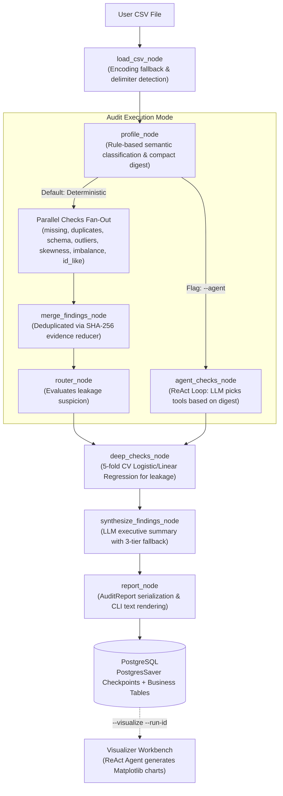

# Data Detective — Architectural Design & File Reference

Data Detective is a LangGraph agent that audits a CSV dataset (missing values, duplicates, imbalance, leakage, bias, outliers, skewness) and produces an evidence-based report before machine learning models are trained.

---

## 1. Executive Summary & Honest Rating

### **Overall Rating: 7.5 / 10** (Evaluated strictly on built features M0–M6: **9.0 / 10**)

| Area | Score | Notes |
| :--- | :---: | :--- |
| **Agentic Architecture** | **9.5 / 10** | Strict separation: LLM never sees raw CSV data, state never holds DataFrames, token budgets are enforced with graceful degradation. |
| **Data Science Robustness** | **9.0 / 10** | Semantic column classification, robust encoding/delimiter detection, and target leakage proof using 5-fold cross-validated ROC AUC and $R^2$. |
| **Code Extensibility** | **9.5 / 10** | `@register_check` decorator pattern allows new checks to auto-register into CLI, parallel graph, ReAct agent tools, and prompts without touching core graph files. |
| **Operational Usability** | **5.0 / 10** | `main.py` currently requires a live PostgreSQL instance running on `localhost:5432` to execute. Needs an in-memory/SQLite fallback. |
| **Project Completeness** | **6.5 / 10** | M0–M6 and Visualizer Workbench are solid. M7 (FastAPI/Streamlit) is currently a 1-line stub (`src/api/__init__.py`). |

---

## 2. System Workflow (Simple English)

The audit workflow operates in two main execution modes, followed by an optional visualizer workbench:

### The 5 Stages of an Audit:
1. **Ingest & Profile (No LLM):** Read CSV with encoding fallback (`utf-8`, `latin-1`, `cp1252`) and delimiter detection. Classify columns into 10 semantic types (`numeric_measurement`, `binary`, `identifier`, `categorical`, etc.).
2. **Audit Execution:**
   - **Deterministic Mode:** LangGraph fans out to parallel check nodes, then merges findings using a SHA-256 deduplicating reducer.
   - **Agent Mode (`--agent`):** Feeds the compact profile digest to Ollama. The LLM selects and calls check tools in a ReAct loop.
3. **Deep Leakage Checks:** Trains 5-fold cross-validated baseline models on suspect columns to mathematically prove target leakage ($AUC > 0.85$ or $R^2 > 0.70$).
4. **Synthesis & Reporting:** The LLM summarizes findings with dynamic next steps (with automatic fallback to plain-text or deterministic summaries if the model fails). The report is printed and saved to PostgreSQL.
5. **Visualizer Workbench:** Running `--visualize` launches a specialized agent that creates Matplotlib plots (.png) for flagged issues (box plots for outliers, histograms for skewness, bar charts for imbalance).

---

## 3. File Directory & Main Functions

### Core & Entry Point
- **`main.py`**: CLI entry point.
  - `main()`: Parses CLI arguments, ensures database tables, runs LangGraph audit, saves run data, or triggers visualizer.
  - `_persisted_graph()`: Context manager attaching `PostgresSaver` checkpointer to the graph.
  - `_build_check_params()` / `_build_semantic_overrides()`: Translates CLI flags into runtime check parameters.
- **`src/config.py`**: Runtime configuration.
  - `Settings`: Pydantic settings loading Ollama and PostgreSQL connection strings from `.env`.
  - `get_settings()`: Cached settings singleton.
- **`src/check_config.py`**: Central threshold storage.
  - `CheckConfig`: Dataclasses holding thresholds for leakage (AUC/$R^2$), bias ($p$-value, disparate impact), outliers (IQR), skewness, missing percentages, and duplicate row ratios.

---

### Schemas (`src/schemas/`)
- **`src/schemas/finding.py`**: Standardized audit problem schema.
  - `Finding`: Pydantic container (`check_name`, `severity`, `evidence`, `affected_columns`, `confidence`).
  - `Finding.__lt__()`: Orders findings by severity (`CRITICAL` > `HIGH` > `MEDIUM` > `LOW` > `INFO`).
- **`src/schemas/report.py`**: Report schemas.
  - `SynthesisResult`: Strict output structure enforced on the LLM summary.
  - `AuditReport`: Complete data contract holding metadata, findings, column profiles, and sample rows.

---

### Graph Architecture (`src/graph/`)
- **`src/graph/state.py`**: LangGraph state.
  - `GraphState`: TypedDict carrying IDs, paths, profile, and findings across nodes (never holds a DataFrame).
- **`src/graph/reducers.py`**: State reducers.
  - `merge_findings()`: Merges finding lists and prevents duplicates using SHA-256 evidence hashing.
- **`src/graph/builder.py`**: State machine constructors.
  - `build_graph()`: Builds deterministic parallel pipeline with conditional routing.
  - `build_agent_graph()`: Builds LLM ReAct agent pipeline with synthesis.
- **`src/graph/nodes.py`**: Core graph nodes.
  - `load_csv_node()`: Validates CSV path.
  - `profile_node()`: Computes dataset summary and column classifications.
  - `router_node()`: Flags columns suspected of target leakage.
  - `deep_checks_node()`: Runs cross-validated baseline models on suspect columns.
  - `report_node()`: Serializes `AuditReport` to JSON and formatted text.
- **`src/graph/agent.py`**: ReAct agent loop.
  - `build_check_agent()`: Compiles LangGraph loop (`agent` <-> `tools`).
  - `run_checks_with_agent()`: Executes the loop using the compact profile digest and aggregates findings.
- **`src/graph/synthesis.py`**: Executive summary generation.
  - `make_synthesize_findings_node()`: Produces synthesis node with 3-tier fallback (Structured JSON -> Plain Text -> Deterministic summary).
  - `_group_findings()`: Groups findings by `(check_name, severity)` to prevent LLM duplication.
- **`src/graph/tools.py`**: Dynamic LangChain tools.
  - `ALL_TOOLS`: Auto-generated `StructuredTool` instances derived from the check registry.
- **`src/graph/llm.py`**: Model factory.
  - `get_llm()`: Builds `ChatOllama` instance from configuration.
- **`src/graph/llm_context.py`**: Token budget protector.
  - `build_llm_digest()`: Compresses column metadata into a bounded token budget (default 2000 tokens) with multi-stage degradation.

---

### Data Tools & Check Registry (`src/tools/`)
- **`src/tools/csv_reader.py`**: Resilient CSV loader.
  - `read_csv_robust()`: Handles encodings (`utf-8`, `latin-1`, `cp1252`), strips BOMs, detects delimiters (`,`, `\t`, `;`, `|`), and caches parsed DataFrames.
- **`src/tools/profiling.py`**: Profiling and semantic classifier.
  - `profile_dataset()`: Extracts missing counts, statistics, and sample rows.
  - `classify_columns()`: Classifies columns into 10 semantic types with confidence and ambiguity flags.
- **`src/tools/missing_markers.py`**: Unified missing detector.
  - `count_missing()`: Counts `NaN` values and string placeholders (`?`, `null`, `NA`, `-`, blanks).
- **`src/tools/target_type.py`**: Target column inspection.
  - `detect_target_type()`: Categorizes target as `binary`, `multiclass`, `continuous`, or `boolean`.
- **`src/tools/checks/registry.py`**: Check registration and contract execution.
  - `register_check()`: Decorator attaching check metadata and accepted semantic types.
  - `run_check()`: Safe execution wrapper handling target-type and required-parameter gating.

---

### Audit Checks (`src/tools/checks/`)
- **`duplicates_check.py`**: Detects exact duplicate rows across the dataset.
- **`missing_check.py`**: Flags columns exceeding missing value thresholds (LOW / HIGH / CRITICAL).
- **`schema_check.py`**: Identifies numeric values improperly stored as string/object text.
- **`id_like_check.py`**: Identifies non-target columns that are unique per row (identifier risk).
- **`imbalance_check.py`**: Flags skewed classification targets (<10% or <30% minority share).
- **`outlier_check.py`**: Detects numeric outliers using Interquartile Range (IQR).
- **`skewness_check.py`**: Computes Fisher-Pearson skewness to flag distributional distortion.
- **`leakage_check.py`**: Runs 5-fold cross-validated logistic/linear models to catch single-feature target leakage ($AUC > 0.85$ or $R^2 > 0.70$).
- **`bias_check.py`**: Analyzes disparate impact and Chi-Square significance across user-defined demographic groups.

---

### Database Layer (`src/db/`)
- **`src/db/connection.py`**: SQLAlchemy engine and session factory (`init_db`, `get_db`).
- **`src/db/models.py`**: Relational ORM models (`Dataset`, `AuditRun`, `Finding`, `Report`).
- **`src/db/repository.py`**: CRUD layer (`save_run`, `list_runs`, `get_run`).

---

### Visualizer Workbench (`src/workbench/visualizer/`)
- **`visualizer_graph.py`**: LangGraph builder for the charting ReAct agent.
- **`visualizer_nodes.py`**: Nodes handling input routing and collecting generated plot paths.
- **`visualizer_tools.py`**: Matplotlib plotting tools generating correlation heatmaps, class imbalance bar charts, outlier box plots, and skewness histograms.

---

### Evaluation (`eval/`)
- **`eval/run_harness.py`**: Evaluation test harness.
  - `run_harness()`: Audits registered datasets (`adult`, `telco`, `house`, `titanic`) in `eval/datasets.yaml` against expected labels in `eval/semantic_gold.yaml`, verifying consistency and deterministic behavior.

---

## 4. Strengths & Known Rough Edges

### Core Strengths
1. **Strict Data Privacy:** Full CSVs are never sent to the LLM. Only compact, token-budgeted profile digests are passed.
2. **Deterministic Fallbacks:** The pipeline never crashes on LLM timeout or invalid JSON; fallback summaries are automatically constructed.
3. **Plug-and-Play Registry:** New checks can be added in a single file with `@register_check` without touching the graph builder or tool definitions.

### Known Rough Edges
1. **PostgreSQL Dependency:** `main.py` requires an active PostgreSQL connection at launch. Adding an in-memory/SQLite fallback when Postgres is offline will significantly improve developer experience.
2. **Leakage Check Performance:** Running 5-fold cross-validation on every column sequentially can become slow on wide datasets.

