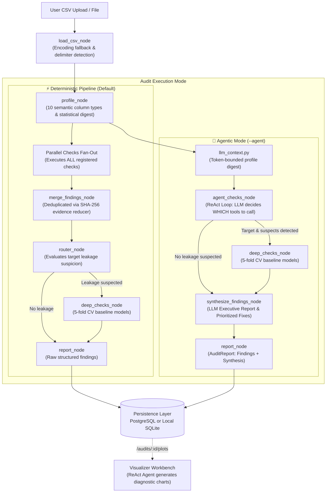

# Data Detective — System Architecture & Technical Reference

Data Detective is an agentic data quality auditing system built with **LangGraph**, **FastAPI**, and **Streamlit**. It inspects tabular CSV datasets for machine learning readiness—identifying missing values, sentinel nulls, exact duplicates, schema corruptions, class imbalance, demographic bias, and feature leakage—and produces an evidence-based audit report before models are trained.

---

## 1. Core Architectural Invariants

1. **Zero Raw Rows to LLM:** Raw CSV rows are never sent into language model prompts. The LLM receives only a compact, token-bounded statistical digest (column data types, null ratios, cardinality, and summary distributions).
2. **State Never Holds DataFrames:** The LangGraph state dictionary (`GraphState`) holds file paths, metadata IDs, column profile dictionaries, and Pydantic findings. DataFrames are loaded within check tools and released immediately.
3. **Pure Functional Calculators:** Python libraries (`pandas`, `scikit-learn`, `scipy`) perform all statistical and machine learning calculations. The LLM acts strictly as a reasoner, orchestrator, and synthesizer.
4. **Empirical Evidence Required:** Speculative claims are disallowed. For instance, a target leakage claim is only confirmed if a 5-fold cross-validated baseline model achieves an $AUC > 0.85$ or $R^2 > 0.70$.
5. **Deterministic Fallbacks:** The pipeline is resilient against LLM failures. If model reasoning, tool selection, or structured output parsing encounters an issue, the system gracefully degrades without crashing.

---

## 2. End-to-End System Workflow

The architecture supports two distinct execution modes: a **Deterministic Pipeline** (runs all checks, outputs findings only) and an **Agentic Audit Mode** (LLM decides which tools to call, followed by an executive synthesis report).



### The 5 Audit Stages:

1. **Ingestion & Semantic Profiling:**
   - Resilient CSV loading (`read_csv_robust`) with automatic encoding fallback (`utf-8`, `latin-1`, `cp1252`) and delimiter detection (`,`, `\t`, `;`, `|`).
   - Rule-based classifier tags columns into 10 semantic types (`numeric_measurement`, `binary`, `identifier`, `categorical`, `text_unstructured`, etc.) with confidence scores and ambiguity flags.
2. **Execution Strategy:**
   - **Deterministic Mode:** LangGraph fans out to all registered check tools in parallel. Gathers raw findings using a SHA-256 deduplicating reducer.
   - **Agent Mode:** The LLM inspects the compact profile digest, reasons about data distributions, and selectively calls check tools via a ReAct loop.
3. **Deep Leakage Validation:**
   - Suspect features undergo 5-fold cross-validated logistic regression or decision trees (`deep_checks_node`) to mathematically verify predictive leakage against the target.
4. **Synthesis & Reporting:**
   - **Deterministic:** Outputs raw structured `Finding` objects without an LLM report.
   - **Agent Mode:** Invokes `synthesize_findings_node` where the LLM produces an executive summary, root-cause assessment, and prioritized remediation actions (backed by a 3-tier fallback).
5. **Persistence & Checkpointing:**
   - Saves run metadata, column profiles, findings, and reports into relational tables with automatic local SQLite fallback when PostgreSQL is unreachable.

---

## 3. Agent Mode & Decision Mechanics

In Agent Mode (`--agent` or `mode="agent"` via API), the LLM functions as an intelligent diagnostic auditor:

```
┌────────────────────────────────────────────────────────┐
│                   Compact Profile Digest               │
│ (Row count, column types, missing rates, sample stats) │
└───────────────────────────┬────────────────────────────┘
                            │
                            ▼
┌────────────────────────────────────────────────────────┐
│                   ReAct Decision Loop                  │
│                                                        │
│ Thought: Column 'tenure' is numeric with high skewness.│
│          Column 'churn' is binary target (imbalanced). │
│          Column 'id' has 100% unique values.           │
│                                                        │
│ Action:  Call check_imbalance(target='churn')          │
│ Observation: Minority class is 14.2% (HIGH severity)   │
│                                                        │
│ Action:  Call check_id_like(columns=['id'])            │
│ Observation: Identifier risk confirmed                │
│                                                        │
│ Action:  Call check_leakage(suspects=['total_charges'])│
│ ...                                                    │
└───────────────────────────┬────────────────────────────┘
                            │
                            ▼
┌────────────────────────────────────────────────────────┐
│                  LLM Synthesis Report                  │
│  • Executive summary of dataset readiness              │
│  • Grouped findings by check name & severity           │
│  • Actionable step-by-step remediation roadmap         │
└────────────────────────────────────────────────────────┘
```

* **Token Budget Protection (`src/graph/llm_context.py`):** Profile digests are bounded by token budgets (default 2,000 tokens) with multi-stage degradation to guarantee deterministic operation even on wide tables.
* **Tool Registry Contract (`src/tools/checks/registry.py`):** Check tools are registered via `@register_check(name, semantic_types, requires_target)`. LangGraph dynamically exposes registered checks as LangChain tools with Pydantic argument schemas.

---

## 4. Service & Interface Architecture

The application is structured as a decoupled multi-tier system:

```
┌───────────────────────────────────────────────────────┐
│                 Streamlit Web UI                      │
│                 (Port :8501, ui/app.py)               │
│   • Dataset upload & configuration                    │
│   • KPI summary cards & findings badges               │
│   • Diagnostic chart viewer & report download (TXT/JSON)
└───────────────────────────┬───────────────────────────┘
                            │ HTTP (REST)
                            ▼
┌───────────────────────────────────────────────────────┐
│                    FastAPI Backend                    │
│               (Port :8000, src/api/app.py)            │
│   • Async background task orchestration               │
│   • Request validation & sanitization                 │
│   • SQLite / PostgreSQL relational persistence        │
└───────────────────────────┬───────────────────────────┘
                            │ Invokes
                            ▼
┌───────────────────────────────────────────────────────┐
│               LangGraph Audit Engine                  │
│             (src/graph/audit_runner.py)               │
│   • Graph state machine execution                     │
│   • Checkpoint persistence & LangSmith tracing        │
└───────────────────────────────────────────────────────┘
```

### FastAPI Endpoints:

| Endpoint | Method | Purpose |
| :--- | :---: | :--- |
| `/health` | `GET` | Health probe verifying database connectivity (PostgreSQL / SQLite) and storage directories. |
| `/audits` | `POST` | Accepts CSV file upload or URL, target column, audit mode (`deterministic` or `agent`), and dispatches an async background task. Returns `202 Accepted` with `run_id`. |
| `/audits/{run_id}` | `GET` | Returns execution status (`running`, `completed`, `failed`), full findings, and synthesis report upon completion. |
| `/audits` | `GET` | Returns historical audit summaries (dataset name, rows, columns, mode, findings count by severity). |
| `/audits/{run_id}/plots` | `POST` | Dispatches the Visualizer Workbench to generate diagnostic Matplotlib charts for flagged findings. |
| `/audits/{run_id}/plots/{filename}` | `GET` | Serves generated plot images (`.png`). |

---

## 5. Visualizer Workbench

The Visualizer Workbench (`src/workbench/visualizer/`) generates targeted diagnostic visualizations for confirmed findings:

* **Class Imbalance:** Target distribution bar charts highlighting majority/minority proportions.
* **Skewness:** Feature distribution histograms with kernel density estimation and skewness indicators.
* **Outliers:** Box-and-whisker plots depicting IQR fences and outlying observations.
* **Feature Leakage:** Correlation matrices and predictive association heatmaps.

Plots are saved under `plots/<run_id>/` and can be retrieved through the REST API or rendered in the Streamlit UI.

---

## 6. Observability & Tracing (LangSmith)

Full execution observability is provided through LangSmith integration:

* **Entry Point Configuration:** `.env` variables (`LANGCHAIN_TRACING_V2=true`, `LANGCHAIN_API_KEY`, `LANGCHAIN_PROJECT`) are loaded into `os.environ` on startup across all entry points (`config.py`, `app.py`, `main.py`, `ui/app.py`).
* **Granular Trace Spans:** Every core node (`load_csv_node`, `profile_node`, `check_*`, `router_node`, `deep_checks_node`, `synthesize_findings_node`, `report_node`) and tool (`generate_plots`) is decorated with `@traceable`.
* **Identifiable Run Naming:** Each graph invocation is tagged with the dataset name and execution mode (e.g. `adult.csv [agent]` or `titanic.csv [deterministic]`), allowing instant filtering in the LangSmith dashboard.

---

## 7. Directory & Module Reference

```
data-detective/
├── main.py                     # CLI entry point (audit, list runs, visualizer)
├── ARCHITECTURE.md             # System architecture & technical reference
├── README.md                   # Project overview, quickstart & API docs
├── ui/
│   └── app.py                  # Streamlit dashboard
├── src/
│   ├── config.py               # Pydantic Settings & environment loader (.env)
│   ├── check_config.py         # Statistical thresholds & configuration
│   ├── api/
│   │   └── app.py              # FastAPI REST endpoints & background worker
│   ├── db/
│   │   ├── connection.py       # SQLAlchemy engine (Postgres + SQLite fallback)
│   │   ├── models.py           # Relational ORM models (Run, Finding, Report)
│   │   └── repository.py       # Persistence repository & data access methods
│   ├── graph/
│   │   ├── state.py            # GraphState definition (no DataFrames)
│   │   ├── reducers.py         # SHA-256 evidence deduplicating reducer
│   │   ├── nodes.py            # State machine graph nodes (@traceable)
│   │   ├── builder.py          # Deterministic & Agent LangGraph builders
│   │   ├── agent.py            # ReAct agent loop for tool selection
│   │   ├── audit_runner.py     # Unified execution runner for CLI & API
│   │   ├── synthesis.py        # Executive summary generation (3-tier fallback)
│   │   └── llm_context.py      # Token-bounded profile digest generator
│   ├── tools/
│   │   ├── csv_reader.py       # Resilient CSV parser (encoding & delimiters)
│   │   ├── profiling.py        # Semantic classification & statistical summary
│   │   └── checks/             # Registered pure-Python audit check tools
│   └── workbench/
│       └── visualizer/         # ReAct charting agent & Matplotlib tools
├── tests/                      # Automated test suite (checks, graph, API, visualizer)
└── eval/                       # Evaluation harness & gold-standard benchmarks
```
