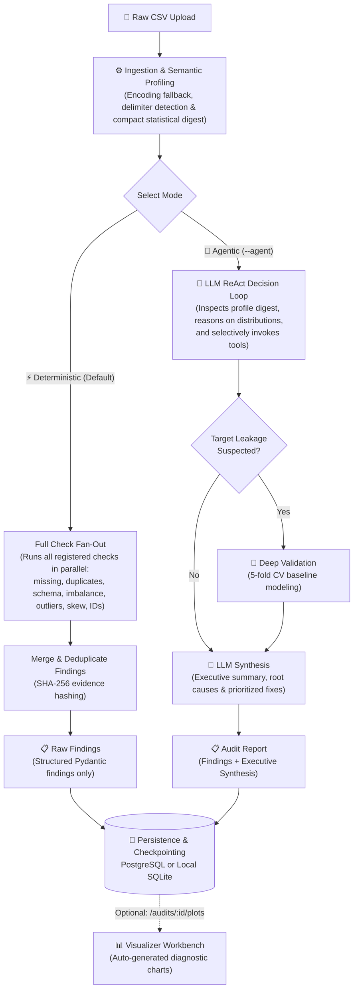

# 🔍 Data Detective

<p align="center">
  <strong>An evidence-based, privacy-first dataset audit agent powered by LangGraph, FastAPI, and Streamlit.</strong>
</p>

<p align="center">
  
  
  
  
  
  
</p>

---

## 💡 What is Data Detective?

Before training machine learning models or deploying analytics pipelines, real-world data is often plagued with silent killers: **target leakage**, **demographic bias**, **severe class imbalance**, **extreme outliers**, and **schema anomalies**.

**Data Detective** is an autonomous dataset auditor built on **LangGraph**. It analyzes tabular datasets through specialized statistical checks and produces an evidence-backed audit report with concrete next steps, paired with an interactive Web UI and REST API.

### 🛡️ Core Design Principles

1. **Privacy & Efficiency by Design:** The LLM **never** receives your raw CSV rows. It only analyzes a compact, token-efficient statistical profile (column types, distributions, null rates, and sample sketches).
2. **Deterministic Calculations, Agentic Reasoning:** Python data tools (`pandas`, `scikit-learn`, `scipy`) compute statistical evidence. The LLM agent orchestrates what to inspect, validates hypotheses, and synthesizes findings.
3. **Evidence-Based Claims:** No hallucinated issues. Every reported finding includes exact numbers (e.g., baseline model AUC for leakage, Disparate Impact ratios for bias, IQR thresholds for outliers).
4. **Dual Engine Execution:**
   - **`agent` mode:** LangGraph agent dynamically plans and runs checks guided by a local LLM via Ollama (e.g. `llama3.1:8b`).
   - **`deterministic` mode:** Runs the full suite of checks systematically with zero LLM dependency.

---

## 🏗️ Architecture



### Execution Modes

* **⚡ Deterministic Pipeline (Default):** Runs the full suite of specialized check tools simultaneously across all eligible columns. Fast, purely rule-based, and outputs structured findings directly with zero LLM overhead.
* **🤖 Agentic Audit Mode (`--agent`):** The LLM receives only a compact, token-budgeted profile digest (column data types, null ratios, and summary statistics). It reasons over the dataset profile, dynamically decides which check tools to invoke with specific arguments, triggers deep 5-fold cross-validation when target leakage is suspected, and synthesizes all evidence into an executive report with prioritized fixes.

> **Service & UI:** The core engine is served through a **FastAPI** backend and an interactive **Streamlit** dashboard. See [`ARCHITECTURE.md`] for full REST API endpoint specifications.

---

## 🔎 Audit Capabilities

| Audit Check | What It Detects | Supporting Evidence |
| :--- | :--- | :--- |
| **Target Leakage** | Features with suspicious predictive power or direct target encoding | Single-feature Logistic/Tree AUC > threshold, correlation spikes |
| **Fairness & Bias** | Demographic disparities across protected attributes | Disparate Impact Ratio, Equal Opportunity differences |
| **Class Imbalance** | Severe minority representation in classification targets | Minority class frequency, imbalance ratio |
| **Missing Markers** | Explicit NaNs and sentinel markers (`"N/A"`, `"-999"`, `"?"`) | Missing percentage per column, marker identification |
| **Duplicate Rows** | Exact row duplication across observations | Count & percentage of duplicate records |
| **Outliers** | Extreme values skewing distributions | IQR & Z-score threshold breaches |
| **Skewness** | Highly skewed numerical feature distributions | Fisher-Pearson skewness coefficient |
| **ID-Like Columns** | High-cardinality identifiers useless for ML models | Cardinality-to-row ratio |

---

## 🚀 Quick Start with Docker (Recommended)

Run the full stack (**FastAPI Backend** + **Streamlit Web UI** + **Persistence**) in a single command with Docker Compose:

### Prerequisites
- [Docker Desktop](https://www.docker.com/products/docker-desktop/) installed and running.
- *(Optional, for Agent mode)* [Ollama](https://ollama.com/) running on your host machine:
  ```bash
  ollama pull llama3.1:8b
  ```

### Launch the Stack

```bash
docker compose up
```

- 🌐 **Streamlit UI:** [http://localhost:8501](http://localhost:8501)
- 📚 **FastAPI Swagger Docs:** [http://localhost:8000/docs](http://localhost:8000/docs)
- 🩺 **Health Check:** [http://localhost:8000/health](http://localhost:8000/health)

### 📥 Viewing & Exporting Audit Results

All audit runs, findings, and reports are saved automatically to SQLite (`/app/data/data_detective.db`).

* **From the Web UI:** Click the **"Past audits"** tab to view audit history or click **Download Report (.txt / .json)**.
* **Copy the SQLite Database to your local machine:**
  ```bash
  # 1. Check your running container name
  docker ps

  # 2. Copy the database file into your current folder
  docker cp data-detective-api:/app/data/data_detective.db ./data_detective.db
  ```

*(Optional)* Run with PostgreSQL instead of SQLite:
```bash
docker compose --profile postgres up
```

---

## 💻 Local Development Setup (Without Docker)

### 1. Clone & Dependencies
```bash
git clone https://github.com/ezekielkharkongor/data-detective.git
cd data-detective

python -m venv .venv
source .venv/bin/activate  # On Windows: .venv\Scripts\activate
pip install -r requirements.txt
```

### 2. Configure Environment
Copy `.env.example` to `.env`. Data Detective works **out of the box with SQLite** without requiring PostgreSQL:
```env
LLM_PROVIDER=ollama
LLM_MODEL=llama3.1:8b
OLLAMA_BASE_URL=http://localhost:11434

# Leave DATABASE_URL empty to default to local SQLite (./data_detective.db)
DATABASE_URL=
```

### 3. Run via CLI

**Deterministic Audit (Fast, rule-based):**
```bash
python main.py data/raw/adult.csv --target income
```

**Agentic Audit (LLM-orchestrated with synthesis report):**
```bash
python main.py data/raw/adult.csv --target income --agent
```

**Fairness & Demographic Bias Audit:**
```bash
python main.py data/raw/adult.csv --target income --sensitive race,sex --favorable >50K
```

**Launch Visualizer Workbench for a completed audit run:**
```bash
python main.py --workbench visualize --run-id <run-id>
```

### 4. Run Backend & Frontend Locally
In one terminal, start the FastAPI server:
```bash
uvicorn src.api.app:app --host 127.0.0.1 --port 8000 --reload
```

In a second terminal, start the Streamlit UI:
```bash
streamlit run ui/app.py
```

---

## 🧪 Testing

Run unit tests and graph integration suites:
```bash
pytest tests/
```

---

## 🛠️ Tech Stack

- **Agent Orchestration:** LangGraph, LangChain
- **LLM Integration:** Ollama (`llama3.1:8b`), LangChain-Ollama
- **Backend API:** FastAPI, Uvicorn, Pydantic v2
- **Frontend Dashboard:** Streamlit
- **Data Science Core:** Pandas, NumPy, Scikit-learn, SciPy
- **Visualization:** Matplotlib, Seaborn
- **Storage & State:** SQLite, PostgreSQL (Psycopg 3), LangGraph Checkpointers
- **Containerization:** Docker, Docker Compose

---

